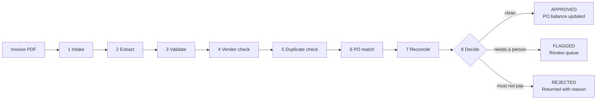

# 🧾 Invoice Autopilot

**Automated accounts-payable invoice processing: a vendor invoice PDF goes in, and a reasoned decision comes out — APPROVED, FLAGGED for review, or REJECTED.**

[](https://invoice-autopilot-h2vtudvryjxpvggd7vqfyb.streamlit.app/)


### ▶ Live app: https://invoice-autopilot-h2vtudvryjxpvggd7vqfyb.streamlit.app/

> Hosted on Streamlit's free tier. If you see a "this app has gone to sleep" screen, click the wake-up button and give it a moment to start.

Built for case study **PS-1 (Finance / Accounts Payable)**. The system reads the invoice, matches it against a mock procurement system (purchase orders, approved vendors, invoice history), validates the numbers, and explains every decision step by step.

---

## Contents

- [Try it in 60 seconds](#try-it-in-60-seconds)
- [Screenshots](#screenshots)
- [How it works](#how-it-works)
- [Edge cases handled](#edge-cases-handled)
- [Design decisions](#design-decisions)
- [Run it locally](#run-it-locally)
- [Deploy your own copy](#deploy-your-own-copy)
- [Project structure](#project-structure)
- [Assumptions and limitations](#assumptions-and-limitations)

---

## Try it in 60 seconds

1. Open the [live app](https://invoice-autopilot-h2vtudvryjxpvggd7vqfyb.streamlit.app/).
2. Go to **Rules & settings** and click **Reset demo data**, so every scenario starts from a known state.
3. Go back to **Process invoice**, choose a sample from the list (or upload your own PDF), and click **Process invoice**.
4. Watch the eight stages run, then read the decision and the reasons behind it.
5. Click **Download decision report (PDF)** for a one-page summary you can save or forward.
6. Open the **Dashboard** to see every run, its status and outputs, and download the report or audit record for any run.

Suggested order: `1 Happy path` → `2 Ghost PO` → `3 Sneaky freight` → `4 Phantom duplicate` → `5a` then `5b Split billing` → `7 Price hike` (then approve it in the **Review queue**).

---

## Screenshots

**Live run** — each stage appears as it executes, with its findings


**Decision** — the outcome, the reasons, what was read, and what changed in procurement


**Dashboard** — history, status and outputs across runs


**Procurement data** — PO balances update as invoices are approved


**Review queue** — a person decides anything the system would not decide alone


---

## How it works



| Stage | What it checks | Can it stop the run? |
|---|---|---|
| **1 Intake** | Is the file a readable PDF? Is it digital or a scanned image? | Yes, if the file is unreadable |
| **2 Extract** | Reads vendor, invoice number, date, PO number, line items, subtotal, tax and total | Yes, if nothing can be read |
| **3 Validate** | Are required fields present? Do the lines plus tax add up to the total? | Only if vendor or total is missing |
| **4 Vendor** | Is the vendor in the approved vendor list? Tolerates "Inc." vs "Inc", "&" vs "and" and small typos | Yes → REJECTED |
| **5 Duplicate** | Same invoice number, or same vendor + date + total under a new number | Yes → REJECTED |
| **6 PO match** | Uses the PO number on the invoice, or infers one when it is missing | No — flags and continues |
| **7 Reconcile** | Compares the total with the PO's **open balance**, applies tolerance, and names the cause of any difference | No — flags and continues |
| **8 Decide** | Rejections outrank flags, flags outrank approvals. Only approvals are posted to the PO | — |

### Data extraction

| Engine | When it is used | Handles scans? |
|---|---|---|
| **Google Gemini** (free tier) | When an API key is configured | ✅ Yes — reads the PDF directly |
| **Local parser** (pdfplumber) | No key configured, or if the Gemini call fails | ❌ Digital PDFs only |

If Gemini is unavailable or rate-limited, the run falls back to the local parser automatically and says so on screen, so a demo never breaks.

---

## Edge cases handled

### The four headline scenarios

| # | Scenario | What happens | Decision |
|---|---|---|---|
| 1 | **Ghost PO** — invoice has no PO number | The vendor has two open POs; exactly one has an open balance equal to the invoice total, so it is attached automatically | `APPROVED - AUTO-MATCHED PO` |
| 2 | **Sneaky freight** — an unplanned $25 shipping charge | Line items match the PO; the $25 freight line is 1.93% over, within tolerance, and named as the cause | `APPROVED - WITHIN TOLERANCE` |
| 3 | **Phantom duplicate** — INV-102 re-sent as INV-102-A | Caught by matching vendor + date + total, not just the invoice number | `REJECTED - SUSPECTED DUPLICATE` |
| 4 | **Split billing** — $4,000 then $6,000 against a $10,000 PO | The first invoice draws down the PO balance; the second uses the rest and closes the PO | `APPROVED - PARTIAL DRAWDOWN` → `APPROVED - FINAL DRAWDOWN` |

### Supporting guardrails

| Scenario | Decision |
|---|---|
| Exact same invoice submitted twice | `REJECTED - DUPLICATE INVOICE` |
| Scanned image with no text layer | `APPROVED` with Gemini · `FLAGGED - UNREADABLE DOCUMENT` without it |
| Unit price raised 15% above the PO | `FLAGGED - OVER TOLERANCE` (the price change is named) |
| Unknown vendor quoting a real PO number | `REJECTED - VENDOR NOT APPROVED` |
| Messy layout: bundled line, tax included in the total, PO mentioned only in a sentence | `APPROVED` |

Also handled in code: missing invoice number or date, totals that don't add up, PO not found, PO belonging to a different vendor, PO already fully invoiced, currency mismatch, several POs fitting a PO-less invoice, and a likely re-issue with a different date. Each is sent to the review queue with the reason.

All ten sample invoices are in [`sample_invoices/`](sample_invoices/).

---

## Design decisions

- **The AI reads; the rules decide.** Gemini only extracts data from the document. Every decision is made by plain, tested Python ([`core/rules.py`](core/rules.py)), so the same invoice always gets the same result and every result can be explained.
- **Tolerance is "5% *and* $50", whichever is stricter.** With "or", a $10,000 PO could be overrun by $500 unnoticed. Both limits are editable in the app.
- **A guessed PO must be exact and unique.** PO inference never applies tolerance. If two POs fit, a person chooses.
- **Invoices are checked against the PO's remaining balance**, not its original value. That is what makes split billing work and stops a PO from being over-drawn.
- **When unsure, ask a person.** Anything ambiguous goes to the review queue with the evidence, instead of being guessed.
- **Every run is auditable.** Each decision stores the extracted data, every stage's findings and the reasons. It can be downloaded as a one-page PDF report for people, or as JSON for other systems.

---

## Run it locally

Requires **Python 3.10+**.

```bash
git clone https://github.com/<your-username>/invoice-autopilot.git
cd invoice-autopilot

python -m venv .venv
source .venv/bin/activate          # Windows: .venv\Scripts\activate

pip install -r requirements.txt
streamlit run app.py
```

The app opens at http://localhost:8501 and works straight away using the local parser, with no API key needed.

### Enable Gemini (free, needed for scanned invoices)

1. Get a free API key at [Google AI Studio](https://aistudio.google.com/apikey).
2. Copy `.streamlit/secrets.toml.example` to `.streamlit/secrets.toml` and add your key:
   ```toml
   GEMINI_API_KEY = "your-key"
   ```
3. Restart the app, then click **Rules & settings → Test Gemini connection**.

If the test says the configured models aren't available, it lists the ones your key can use. Add one to `secrets.toml`, for example `GEMINI_MODELS = "gemini-3.5-flash-lite"`.

### Run the tests

```bash
pip install -r requirements-dev.txt
pytest -q                            # 13 tests, no API key or internet needed
python scripts/generate_samples.py   # optional: regenerate the sample PDFs
```

---

## Deploy your own copy

**Streamlit Community Cloud (free)**

1. Fork or push this repository to your GitHub account.
2. Go to [share.streamlit.io](https://share.streamlit.io), sign in with GitHub and click **Create app**.
3. Choose the repository, branch `main`, and main file `app.py`.
4. Under **Advanced settings**, pick Python 3.12 and add your key in **Secrets**:
   ```toml
   GEMINI_API_KEY = "your-key"
   ```
5. Click **Deploy**.

Note: the free tier puts the app to sleep after 12 hours without visitors, and run history resets when it restarts.

---

## Project structure

```
invoice-autopilot/
├── app.py                      Streamlit UI: live run, dashboard, review queue, data, settings
├── core/
│   ├── extractor.py            Stage 2: Gemini + local parser, one output format
│   ├── rules.py                Business rules as pure, testable functions
│   ├── pipeline.py             The 8 stages, decision logic, posting, human review
│   ├── report.py               One-page PDF decision report for any run
│   └── store.py                Mock procurement system (JSON files)
├── data/seed/                  Starting data: vendors, purchase orders, invoice ledger, settings
├── sample_invoices/            10 demo invoice PDFs + manifest
├── scripts/generate_samples.py Recreates the sample PDFs
├── tests/test_pipeline.py      13 tests covering every scenario
├── docs/screenshots/           Images used in this README
└── requirements.txt
```

### Tech stack

| Layer | Choice |
|---|---|
| UI | Streamlit |
| Extraction | Google Gemini API (free tier) with a pdfplumber fallback |
| Business logic | Python (pure functions, no framework) |
| Mock procurement system | JSON files |
| Tests | pytest |
| Hosting | Streamlit Community Cloud |

---

## Assumptions and limitations

**Assumptions**
- PO values include tax; PO line prices are before tax.
- One invoice relates to one PO.
- A rejected invoice does not block a corrected re-submission; an approved or in-review one does.
- Unknown vendors are rejected rather than flagged, because vendor onboarding is a separate process.

**Current limitations**
- The local parser handles common invoice layouts; unusual layouts and scans need Gemini.
- JSON files stand in for a real procurement system. Only [`core/store.py`](core/store.py) would need replacing to connect a real database or ERP.
- No credit notes, multi-PO invoices, or three-way matching against goods receipts yet.
- Single user: no login, and the hosted demo's data resets when the app restarts.

**Next steps**
- Three-way match (PO + goods receipt + invoice)
- Email inbox intake so invoices arrive automatically
- Configurable approval routing by amount or department
- Swap JSON storage for a real database
